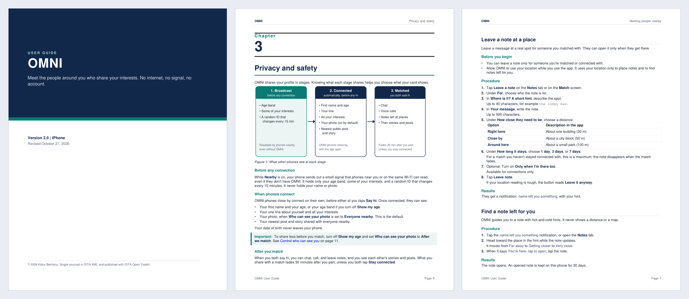
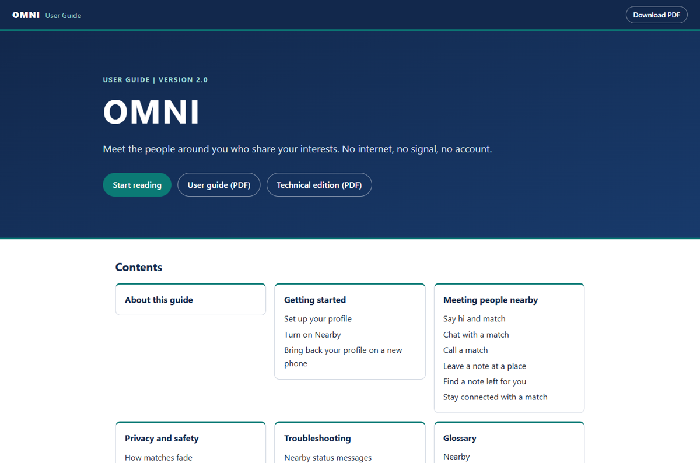
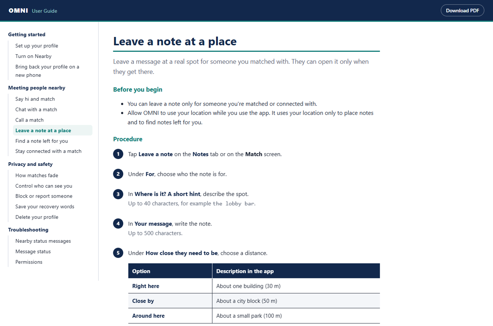
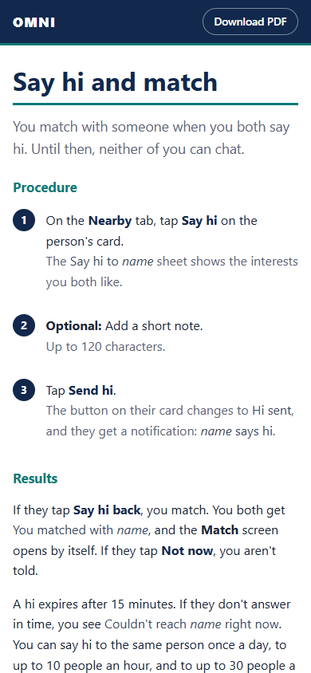

# OMNI user guide, single-sourced in DITA

[](https://github.com/KidusB9/omni-mesh-dita/actions/workflows/publish.yml)

**[Help site](https://kidusb9.github.io/omni-mesh-dita/)** ·
**[User guide (PDF)](https://kidusb9.github.io/omni-mesh-dita/pdf/OMNI-MESH-User-Guide.pdf)** ·
**[Technical edition (PDF)](https://kidusb9.github.io/omni-mesh-dita/pdf/OMNI-MESH-Technical-Edition.pdf)**

The end-user documentation for **OMNI** (listed as [OMNI MESH on the App Store](https://apps.apple.com/us/app/omni-mesh/id6761793813)),
an iPhone app I built that lets people who are physically close meet, chat, and call phone to phone, with no internet
and no server. The guide is written once in DITA XML and published to an HTML5 help site and two PDF editions by
DITA Open Toolkit 4.4.1, through two custom publishing plugins and a PowerShell and batch build toolkit. Every
procedure, label, limit, and timer was checked against the app's 2.0 source code.



## What the source demonstrates

| Technique | Where |
|---|---|
| Bookmap with preface, five chapters, and a glossary list | [`dita/omni-mesh-user-guide.ditamap`](dita/omni-mesh-user-guide.ditamap) |
| 36 topics, typed as concept, task, reference, and glossentry | [`dita/`](dita/) |
| Strict task model: `prereq`, `context`, `steps` with `info`, `stepresult` and `choicetable`, `result`, `tasktroubleshooting`, `example`, `postreq` | [`dita/tasks/`](dita/tasks/) |
| Keys for the product name, version, minimum iOS, and the App Store link (`keyref`) | [`dita/keys.ditamap`](dita/keys.ditamap) |
| Reuse library pulled in with `conkeyref`: notes, phrases, and whole steps | [`dita/common/reuse.dita`](dita/common/reuse.dita) |
| Conditional processing: one source, a user and a technical edition, including a profiled cover subtitle | [`filters/`](filters/), `@audience` |
| Relationship table that generates related links in both directions | `<reltable>` in the bookmap |
| Semantic UI markup: `uicontrol`, `wintitle`, `menucascade`, `msgph`, `varname`, `userinput` | throughout |
| An SVG figure that renders natively in both the PDF and the site | [`dita/images/sharing-layers.svg`](dita/images/sharing-layers.svg) |

## Publishing plugins

### `com.kidusberhanu.omni.pdf` (transtype `omni-pdf`)

Extends PDF2 through a customization directory, following the DITA-OT plugin pattern:

- **XSL-FO attribute-set overrides** ([`cfg/fo/attrs/custom.xsl`](plugins/com.kidusberhanu.omni.pdf/cfg/fo/attrs/custom.xsl)):
  a palette defined once as variables, sans-serif body text, colored heading rules, tinted notes, navy table headers,
  hairline borders, and a navy chapter opener.
- **Template overrides** ([`cfg/fo/xsl/custom.xsl`](plugins/com.kidusberhanu.omni.pdf/cfg/fo/xsl/custom.xsl)):
  a front cover built entirely from bookmap metadata (title, edition, tagline, version, platform, revised date, rights),
  and one running header and footer (product, current chapter, document title, page number) on body, preface,
  contents, and glossary pages.
- **Page model for on-screen reading:** US Letter, no blank padding pages (`force-page-count="no-force"`), and page
  numbering that restarts at 1 on the first chapter through PDF2's `startPageNumbering` hook.
- **Localizable strings** in [`cfg/common/vars/en.xml`](plugins/com.kidusberhanu.omni.pdf/cfg/common/vars/en.xml).

### `com.kidusberhanu.omni.html5` (transtype `omni-html5`)

- **Theme** ([`css/omni.css`](plugins/com.kidusberhanu.omni.html5/css/omni.css)): sidebar navigation, numbered step
  badges, notes, tables, dark mode, and a layout that works down to phone width.
- **Site chrome** through `args.hdr`, `args.ftr`, and `args.hdf`, with the full navigation tree on every page.
- **Branded landing page** for `index.html`, added through the `dita.xsl.html5.cover` extension point
  ([`xsl/landing.xsl`](plugins/com.kidusberhanu.omni.html5/xsl/landing.xsl)). Extension points are global to the
  toolkit, so the override only fires when a parameter that this transtype passes through
  `dita.conductor.html5.toc.param` is set. Stock `html5` builds are unaffected.

| Landing page | Topic page | Phone |
|---|---|---|
|  |  |  |

## Build toolkit

| File | What it does |
|---|---|
| [`setup.bat`](setup.bat), [`scripts/setup.ps1`](scripts/setup.ps1) | Checks for Java 17+, downloads DITA-OT 4.4.1, verifies its SHA-256 against a pinned value, installs both plugins, and confirms the two transtypes registered |
| [`build.bat`](build.bat), [`scripts/build.ps1`](scripts/build.ps1) | Runs `dita validate` on both editions, publishes each deliverable in strict processing mode, copies the PDFs into the site, checks every expected output, and exits non-zero on any failure |
| [`project.xml`](project.xml) | DITA-OT project file: two contexts (user and technical) and three deliverables |
| [`.github/workflows/publish.yml`](.github/workflows/publish.yml) | Runs the same `.bat` files on a Windows runner for every push and pull request, uploads the PDFs as artifacts, and deploys the site to GitHub Pages from `main` |

## Build it yourself

Requires Windows with Windows PowerShell 5.1 or later, and Java 17 or later on `PATH`.

```bat
setup.bat              :: once: download DITA-OT and install the plugins
build.bat              :: validate, then publish everything (about 30 seconds)
build.bat pdf-user     :: publish one deliverable: site, pdf-user, or pdf-technical
```

Output lands in `out/`: `out/site` is the help site (with the PDFs under `out/site/pdf`) and `out/pdf` holds both PDFs.

## Repository layout

```
dita/
  omni-mesh-user-guide.ditamap   bookmap: structure, metadata, reltable
  keys.ditamap                   key definitions
  common/reuse.dita              conkeyref library (resource-only)
  concepts/ tasks/ reference/ glossary/ images/
filters/                         user.ditaval, technical.ditaval
plugins/
  com.kidusberhanu.omni.pdf/     PDF2 customization (XSL-FO)
  com.kidusberhanu.omni.html5/   HTML5 theme, chrome, landing page
scripts/                         setup.ps1, build.ps1
project.xml                      deliverables
setup.bat, build.bat             one-command entry points
```

## License

[MIT](LICENSE)
